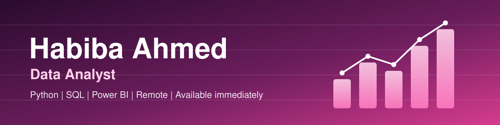

  

  
  
  
  

## About me

Entry-level **Data Analyst** from Minya, Egypt, finishing a B.Sc. in Artificial Intelligence (Data Analysis track) at Minia National University (expected 2027). I clean data, explore it, build Power BI dashboards, and train machine learning models with Python and SQL.

**Available immediately. Open to remote work and relocation.**

## Featured projects

| Project | What it shows | Tools |
|---|---|---|
| [**CreditLens: Credit Card Default Risk Analysis**](https://github.com/habibahmed252/CreditLens-Banking-Credit-Risk-Analytics) | EDA of 30,000 customers. Repayment behavior, not demographics, predicts default: customers 2 months late default at 69% vs 14%. | Python, Pandas, Seaborn |
| [**Pharmaceutical Sales Performance Dashboard**](https://github.com/habibahmed252/Pharmaceutical-Sales-Performance-Dashboard) | Power BI dashboard on 135,668 transactions (EGP 108.91M in sales) comparing Retail, Store and Tender channels. | Power BI |
| [**Smart Stick for the Blind (IoT team project)**](https://github.com/habibahmed252/Smart-Stick-for-the-Blind-IoT) | 11-person team. Detects obstacles within 20 cm with an HC-SR04 ultrasonic sensor and warns with a buzzer and LED. | Arduino, C/C++ |

More projects: [BMW Global Sales Analysis](https://github.com/habibahmed252/BMW-Global-Sales-Analysis-2010-2024), [WUZZUF Egypt Job Market Analysis](https://github.com/habibahmed252/wuzzuf-egypt-job-market-analysis), [Telco Customer Churn Prediction](https://github.com/habibahmed252/Telco_Customer_Churn-Analysis-with-machine-learning-prediction-). See all of them on my [portfolio](https://habibahmed252.github.io/).

## Skills

- **Data analysis:** Python, SQL, R, Pandas, NumPy, EDA, data cleaning, statistical analysis, forecasting
- **BI and visualization:** Power BI, DAX, Power Query, Tableau, Looker Studio, Excel, dashboards
- **Machine learning:** Scikit-learn, classification, predictive modeling, feature engineering, model evaluation
- **Tools:** Streamlit, Jupyter Notebook, Google Colab, VS Code, Git, GitHub

## Currently learning

Google Data Analytics Professional Certificate (Coursera), in progress.

## Get in touch

- Portfolio: [habibahmed252.github.io](https://habibahmed252.github.io/)
- CV: [Download PDF](https://habibahmed252.github.io/Habiba_Ahmed_CV.pdf)
- LinkedIn: [Habiba Ahmed](https://www.linkedin.com/in/habiba-ahmed-77b45b3a7)
- Email: habiba2202230@gmail.com
